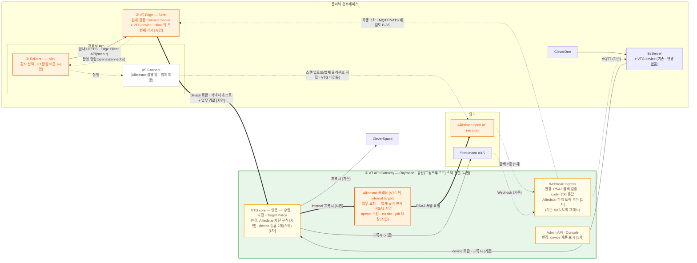
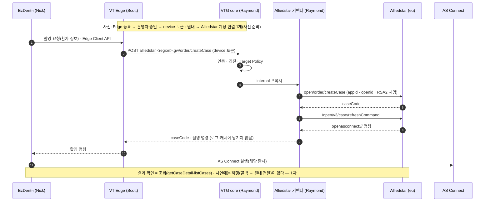

# EzDent-i · VT Edge · VT API Gateway — Alliedstar IO 스캐너 연동 OnePager (2026-11-09)

> Engineering One Pager · **초안** · 시연 목표 = **ADF 2026(11/24~) · 리허설 11/20** · 유럽 GW 선반영
>
> 이 문서는 **전체 구성과 세 개발 지점(EzDent-i · VT Edge · VTG)의 범위, 인프라 요청**을 정리한다. 근거 = 2026-11-09 Scott·Raymond 논의, PR 리뷰 5건(같은 폴더), GW 저장소 handoff 2건(`ezserver-edge-direct-clients.md`·`alliedstar-edge-integration.md` r3), 상위 폴더의 킥오프 회의록(2026-09-28)·VTS COMM-1841, Alliedstar 공식 문서(API List·Security).

| 항목 | 내용 |
| --- | --- |
| 문서 유형 | Engineering One Pager (긴급 프로젝트) |
| 상태 | **초안** — 개발 분장 확정(11/09) · 남은 결정 3건(§8.6) |
| 작성 | Raymond (VTG 리드) |
| 한 줄 목표 | **EzDent-i 에서 환자를 고르면, 원내 VT Edge 가 VTG 를 거쳐 Alliedstar 에 케이스를 만들고 그 PC 에서 촬영 앱을 띄운다** |

---

## 1. Project Name

**Alliedstar IO 스캐너 연동 — EzDent-i · VT Edge · VT API Gateway** (ADF 2026 시연)

## 2. Date

2026-11-09

## 3. Submitter Info

| 역할 | 담당 | 개발 지점 |
| --- | --- | --- |
| 결정권자 · PM | Scott (실장) | — |
| **EzDent-i · IO 스캐너 연동** | **Nick** | 원내 클라이언트 |
| **VT Edge** | **Scott** | 원내 공용 Connect Server |
| **VT API Gateway(VTG) · Alliedstar 커넥터** | **Raymond** | 클라우드 |
| 인프라(유럽 스택) | Jack | — |
| 기획 | Owen (COMM-1841 · 9/28 킥오프) | — |
| Alliedstar 창구 | Lawrence Chen (Upstream Product Manager) · Shelly Tan | — |

## 4. Project Description

- 원내 **EzDent-i** 에서 환자를 고르고 IO 스캐너 촬영을 누르면, 원내 공용 **VT Edge** 가 요청을 받아 **VTG** 로 보낸다.
- VTG 뒤의 **Alliedstar 커넥터**가 업체 규격(개발사 자격·RSA2 서명·사용자 `openid`)으로 케이스를 만들고 촬영 명령을 받아 온다.
- 그 명령으로 요청한 PC 에서 Alliedstar 촬영 앱(AS Connect)이 해당 환자로 뜬다.
- Edge 는 EzServer 와 나란히 **같은 clinic 의 별도 GW device** 로 직접 연결한다(EzServer 경유 아님).
- **EzServer 는 이번에 바뀌는 것이 없다**(11/09 합의). EzServer 의 인증·프록시·AXS webhook 수신은 그대로이고, 시연·1차의 어떤 변경도 EzServer 수정을 요구하지 않아야 한다.
- 11/24 ADF 시연을 위해 **유럽(프랑크푸르트) VTG 스택**에 먼저 올린다.

## 5. Business and Marketing Justification

- **이미 합의된 방향** — 9/28 Alliedstar 킥오프(COMM-1841)
  - 요청 = 프랑스·인도 법인(Alliedstar 판매국 = 프랑스·스페인·인도). 프랑스 PMS(WeClever)도 같은 업체 API 로 연동 중
  - **1차** = EzDent-i(이후 CleverOne)에서 환자 정보를 넘겨 촬영 실행 · **2차** = 촬영 데이터를 EzServer 에 저장
  - **연동은 VT API Gateway 를 거친다** · 공개 API 라 NDA 불필요 · Straumann SIRIOS 연동과 별개 건
- **시연 일정** — ADF 11/24 시작, 리허설 11/20(금)
- **제품 방향** — EzServer 를 한 번에 바꾸지 않고 기능별로 Edge 로 옮긴다. 같은 원내 두 기기의 독립 인증 공존은 VTG 가 이미 지원한다(1:N · PR 15932 확인)
- **VTG 가 막아야 할 빈틈** — Target Policy 를 만든 이유가 Alliedstar 에도 그대로 있다
  - 업체 인증은 개발사 자격 하나이고 원내 범위는 요청의 `openid` 로 정한다
  - `getCaseDetail`(caseCode 만)·`listOrders`(`unionid` 만으로도)·`toothsplit`·`createUser` 는 `openid` 로 갇히지 않는다 → **다른 원내의 케이스(환자 정보) 조회 가능**
  - 그래서 `openid` 는 Edge 가 아니라 **커넥터가 검증된 원내 연결에서 넣는다**(handoff r3 원칙)

## 6. Risk Assessment

| 리스크 | 영향 | 대응 |
| --- | --- | --- |
| ⚠ **일정** — 유럽 스택 0 에서 시작 · 실질 9 영업일 · 세 지점 동시 개발 | 시연 불가 | 시연 범위를 최소 경로로 고정(§8.1) · 콜백·사용자 승인 흐름은 1차 · 지점 간 계약을 11/11 까지 고정(§8.3) |
| ⚠ **실 업체 자격 미수령** — 공개 테스트 자격은 `listCases` 전용 | 케이스 생성·촬영 시연 불가 | 실 `appid`·RSA2 키·사전 연결 계정을 Lawrence Chen 에 요청(Scott) — **11/13 까지 못 받으면 시연을 조회로 축소** |
| ⚠ **Edge ↔ 실제 VTG 연결 미시험** — Edge 는 지금 로컬 모의 GW 로만 동작 | 등록·토큰 실패 | **서울 dev VTG 로 11/11 부터 먼저 시험**(유럽 스택 기다리지 않음) |
| 유럽 스택에 실 환자 정보 · GDPR(COMM-1841 고려 사항) | 리전·주권 위반 소지 | 시연 스택은 test 성격 · 실 환자 정보 금지 · 업체 eu site 로만(결정 1) |
| 다른 원내 데이터 노출(§5) | 환자 정보 유출 | 커넥터 `openid` 주입·caseCode 소유 확인 · Target Policy 로 `createUser`·`toothsplit` 차단 |
| 업체 콜백 형식이 VTG 수신부와 다름(Owen 검토) — RSA2 서명·`code=200` 응답·독립 이벤트 ID 없음 | 결과 수신 불가·중복 | 시연은 콜백 없이 조회로 · 1차에 설계 |
| VTG v1.0 스펙 범위 밖(device = EzServer 뿐 · prod = 시드니 단일 리전) | 정합 비용 | Edge device·유럽 리전·커넥터를 결정 기록으로 먼저 남김 — 스펙 승인이 관문 |
| 운영자가 같은 원내 두 기기를 구분 못함 | 엉뚱한 기기 폐기 | 1차에 device 제품 기록·Console 표시 · 시연은 수작업 확인 |
| 유럽 스택 운영자 권한 — 리전 간 운영자 복제는 gw/1.2 설계(미구현) | Console 로그인 불가 | 시연 스택에 운영자를 따로 등록 |
| Target Policy 마무리와 겹침 | VTG 인력 분산 | Target Policy 는 11/10 구현·11/11 테스트로 끝남 |

## 7. Resource and Scheduling Details

| 날짜 | EzDent-i (Nick) | VT Edge (Scott) | VTG (Raymond) | 인프라 (Jack) |
| --- | --- | --- | --- | --- |
| 11/10(화) | 지점 간 계약 확인 | Edge Client API(`scan.*`) 계약 공유 | Edge → VTG 계약(호스트·업무 경로) 확정 · 스펙 결정 기록 | 유럽 스택 요청 확인(§8.5) |
| 11/11(수) | | **서울 dev VTG 로 등록·토큰 첫 시험** | Edge 승인·확인 · Target Policy 테스트 완료 | |
| 11/12~13 | 촬영 버튼 → Edge 호출 | Alliedstar 업무 15개 → VTG 호출 | **커넥터 구현**(서명·`openid` 주입·job 대장) · 업체 테스트 서버로 검증 | **유럽 스택 기동(11/13)** |
| 11/13(금) | **실 업체 자격 수령 확인 → 시연 범위 결정**(Scott) | | | |
| 11/16~19 | AS Connect 실행·상태 표시 | 촬영 명령 전달·설치 패키지 | 유럽 스택에 VTG·커넥터 배포 · target 등록·Target Policy · 경로 실측 | 배포 파이프라인·DNS 확인 |
| **11/20(금)** | **시연 리허설 — 유럽 VTG · 시연 PC 1대 · 사전 연결 계정** | | | |
| 11/24(화)~ | ADF 시연 | | | |
| 2027-01 | 1차 — 실제 촬영 Case 요청(handoff 목표) | | | |
| 2027-Q2 | 2차 — EzServer 결과 저장(handoff 목표) | | | |

## 8. Technical Description

### 8.0 구성도 — VTG 전체 구성(SRS §2.1)에서 바뀌는 것

SRS §2.1 제품 조망도에 이번 연동을 얹었다. **주황 = 새로 생김 · 노랑 = 기존 것이 바뀜 · 흰색 = 변화 없음.** 꼬리표 `[시연]` = 11/20 까지 · `[1차]` = 2027-01 목표. 상자 위 이름 = 개발 담당.

- **Alliedstar 커넥터란** — Edge 가 보낸 업무 요청(예 "이 환자로 케이스 생성")을 Alliedstar 규격 요청으로 바꿔 대신 보내는 VTG 쪽 코드다.
  - 하는 일: 개발사 자격(`appid`·RSA2 키) 보관 · 공통 파라미터(`timestamp`·`sign_type` 등) 채움 · 원내 계정 연결에서 `openid` 주입 · RSA2 서명 · eu site 로 호출 · 어느 원내가 어떤 케이스를 만들었는지 job 대장에 기록
  - **VTG core 안이 아니라 VTG 뒤의 별도 앱**(internal target)으로 둔다 — VTG core 프록시는 본문을 그대로 전달하는 원칙이라 본문을 다시 쓰고 상태를 갖는 업체 전용 로직을 넣지 않는다. Target Policy·인증·리전 판정은 커넥터 앞에서 VTG core 가 그대로 한다
  - 위치는 VTG 저장소 안의 앱 하나(배포 단위 추가). Raymond 범위
- **Edge ↔ VTG 계약** — Edge 는 `alliedstar.<region>.gw.<도메인>` 같은 **커넥터 target 호스트**에 업체 업무 경로(`/order/createCase` 등 15개)를 붙여 호출한다. `/v1/alliedstar` 는 Edge 로컬 개발용 모의 GW 주소일 뿐이다(handoff r3).
- **변화 없음** — **EzServer**(인증·프록시·AXS webhook 수신·MQTT 구독 그대로) · CleverOne · AXS · CleverSpace 경로. 스캔 파일 바이트는 VTG 를 지나지 않는다.
- **EzServer 를 건드리지 않기 위한 제약** — 1차의 Alliedstar 하행은 **새 stream 토픽**(`gw/clinic/{clinicId}/alliedstar`)을 추가하는 방식으로 하고, EzServer 가 지금 받는 AXS 하행 토픽(`gw/clinic/{clinicId}/webhook`)은 이름·내용을 바꾸지 않는다. EzServer 는 모르는 stream 을 무시하므로(SRS §7.6.6) 새 토픽이 와도 영향이 없다 — 1차 설계 때 이 전제를 Thomas 와 한 번 확인한다.

### 8.1 시연 흐름 (11/20 범위)

### 8.2 개발 범위 — 세 지점

#### ① EzDent-i · IO 스캐너 연동 — Nick

| 구분 | 범위 |
| --- | --- |
| **시연** | 환자 화면에 IO 스캐너 촬영 버튼 · 원내 Edge Client API 호출(환자 정보 전달·촬영 요청) · Edge 에서 받은 촬영 명령으로 **이 PC 에서 AS Connect 실행** · 진행 상태 조회·표시 · Edge 주소·인증 설정 |
| 1차 | 오류·재시도 UX(케이스 생성 결과 불명 시 재생성 금지 안내) · 재촬영 · CleverOne 적용 검토 |
| 의존 | Edge Client API 계약(Scott) · 시연 PC 에 AS Connect 설치 |
| 안 하는 것 | Alliedstar 를 직접 호출하지 않는다(업체 자격은 VTG 커넥터만 가짐) |

#### ② VT Edge — Scott

| 구분 | 범위 |
| --- | --- |
| **시연** | **실제 VTG 에 device 로 등록·토큰 발급·갱신**(지금은 모의 GW 만 · 서울 dev 로 먼저) · 원내 Client API(HTTPS·클라이언트 인증·operation ACL) · Alliedstar 플러그인: 업무 15개를 커넥터 호스트로 호출 · 촬영 명령을 요청한 PC 로만 전달(로그·캐시 금지) · 시연 서버 설치 패키지 |
| 1차 | VTG 하행 수신 — Alliedstar 이벤트만(전달 방식 MQTT/NATS 는 VTG 백로그 B-35 결정 따름) · 결과 수집·저장 · 운영 패키지·업데이트 |
| 의존 | VTG 등록·승인(Raymond) · 커넥터 호스트·응답 계약(Raymond) |
| 안 하는 것 | `appid`·RSA2 키·`openid`·업체 host 를 보관하거나 입력받지 않는다 |

#### ③ VT API Gateway (VTG) — Raymond

| 구분 | 범위 |
| --- | --- |
| **시연** | **Alliedstar 커넥터**(새 앱): 업무 15개 → 업체 규격 변환 · RSA2 서명(PR 15933 helper 사용) · `openid`·`unionid` 주입(사전 연결 계정 1개) · `getCaseDetail` 은 job 대장으로 소유 확인 · eu site 호출 · 촬영 명령 비기록 |
| **시연** | 커넥터를 internal target 으로 등록(호스트 라우팅·timeout) · **Target Policy 규칙**(`createUser`·`toothsplit` 등 차단) · egress 허용 목록(업체 eu host) |
| **시연** | Edge device 수용 확인(코드 변경 없음 예상 · 호환성 매트릭스 제품 항목 확인) · 승인 · 유럽 스택 설정값·검수 · 경로 실측(등록→토큰→프록시→차단 403→감사) |
| **스펙** | 결정 기록: Edge = 두 번째 device 종류 · 유럽 리전 · 커넥터 target 모델 — 스펙 PR 이 관문 |
| 1차 | 원내 ↔ Alliedstar **사용자 승인 흐름**(업체 `auth-login` redirect/notify 를 VTG 고정 endpoint 로 · 연결·해제) · **콜백 수신**(RSA2 검증 · `code=200` 응답 · `userOpenid` → 원내 · 중복 판정 규칙) · **Alliedstar 하행 토픽 추가**(새 stream `gw/clinic/{clinicId}/alliedstar` — 기존 `webhook` 토픽 아래에 두지 않는다: EzServer 가 `webhook` 하위를 AXS 이벤트로 처리할 수 있어서) · device 제품 기록·Console 표시 · 실제 폐기 경로 공존 테스트 · 내구 job 대장·멱등 |
| 의존 | 유럽 스택(Jack) · 실 업체 자격(Scott → 업체) |

### 8.3 지점 간 계약 (11/11 까지 고정)

| 계약 | 소유 | 소비 | 내용 |
| --- | --- | --- | --- |
| Edge Client API(`scan.*`) | Scott | Nick | 촬영 요청(환자 정보) · 상태 조회 · 촬영 명령 수신 |
| Edge → VTG | Raymond | Scott | 커넥터 호스트 + 업무 경로 15개 · 요청·응답 형식(업체 응답 `{code,msg,data}` 를 그대로 줄지 감쌀지) · 오류 코드 · device 토큰 |
| 촬영 명령 전달 | Scott | Nick | `openasconnect://` 명령을 요청 PC 로만 · 일회성 |

### 8.4 인프라 — Jack (유럽 스택)

| # | 항목 | 내용 | 시점 |
| --- | --- | --- | --- |
| I1 | 클러스터 | 프랑크푸르트 EKS(CleverSpace 클러스터) 네임스페이스 · VTG 배포 단위 4개(core·admin·receiver·dispatcher) **+ Alliedstar 커넥터 1개** | 11/13 |
| I2 | 데이터 | PostgreSQL(리전 로컬) · Valkey · 마이그레이션 실행 경로 | 11/13 |
| I3 | IoT | AWS IoT Core(eu-central-1) — device 인증서 발급 권한·정책·브로커 endpoint | 11/13 |
| I4 | 키·비밀 | KMS 키(target 자격·payload) · **Alliedstar `appid`·RSA2 개인키 보관**(커넥터만 읽기) | 11/16 |
| I5 | DNS·인증서 | `*.<eu-region>.gw.<도메인>` — `api`·`admin`·**커넥터 target 호스트**(`alliedstar.…`) · 1차: 콜백 수신 호스트 | 11/13 |
| I6 | egress | NAT(고정 egress IP) · 업체 eu host 로 나가는 허용 — **업체가 IP 허용 목록을 요구하는지 확인 필요** | 11/16 |
| I7 | 운영자 접근 | Console(Entra) 로그인 · 유럽 스택 운영자 등록 | 11/16 |
| I8 | 배포 | 유럽 스택 배포 파이프라인 · 이미지 · 설정값(`GW_REGION` 등) | 11/16 |
| I9 | Region Directory | 유럽 리전 항목 — 시연 스택 성격에 따라(결정 1) | 11/16 |
| I10 | 관측 | 로그·지표 수집(Grafana) | 11/19 |

- 리전 완전 분리 설계라 **스택을 하나 더 세울 뿐 리전 간 배선은 없다.**
- Edge 첫 연결 시험은 기존 **서울 dev 스택**으로 한다 — 유럽 스택을 기다리지 않는다.
- 범위 밖: Pelagus·PMS·Oralsight·WeClever 의 유럽 EKS 배포(Jack 별도 작업).

### 8.5 PR 리뷰 처리 (11/09)

| PR | 내용 | 처리 |
| --- | --- | --- |
| 15931 | 공존·전환 원칙 문서 | 승인 · 의견 = 스펙 범위·기기 구분·업체별 수신자 |
| 15932 | 독립 인증 공존 e2e | 승인 · 실제 폐기 경로 보강 제안 |
| 15933 | RSA2 서명 helper | 승인 · 커넥터가 사용 |
| 15934 | Alliedstar API 대응 문서 | Scott 요청으로 Raymond 가 직접 반영(r3 — 모의 GW 주소 한정·커넥터 원칙·분장) |
| 15935 | 의존성 보안 패치 | **abandon** — 같은 수정이 PR 15946 으로 main 에 먼저 반영 |

### 8.6 남은 결정 (Scott)

| # | 결정 | 추천 |
| --- | --- | --- |
| 1 | 유럽 VTG 의 성격 | **시연용 test 성격 스택** · 실 환자 정보 금지 · 유럽 운영 오픈은 별도 결정(v1.0 prod = 시드니 단일 리전) |
| 2 | 시연 범위 | **사전 연결 계정 1개 · 케이스 생성·촬영 실행·조회** · 콜백·사용자 승인 흐름은 1차 |
| 3 | 실 업체 자격 수령 | Scott 이 Lawrence Chen 에 요청 — **11/13 미수령 시 시연을 조회로 축소** |

### 8.7 정본

- VTG 계약(라우팅·인증·리전·Target Policy) = `vt-api-gateway/docs/specs`(SRS·OpenAPI·DBML) — 이번 변경은 스펙 결정 기록으로 반영
- 연동 근거 = VTG 저장소 `docs/handoff/` 2건(Draft) — SRS 를 대신하지 않는다
- 업체 계약 = Alliedstar 공식 문서(API List·Security, 2026-11-09 확인)
- 사업 합의 = `../2026-09-28 [ES-Alliedstar] Alliedstar IO Scanner 연동 킥오프 미팅.md` · VTS COMM-1841

## 9. Terms and Abbreviations

| 용어 | 뜻 |
| --- | --- |
| VTG | VT API Gateway |
| VT Edge | 원내 공용 Connect Server — 원내 클라이언트 API·스캐너 플러그인. VTG 입장에서는 EzServer 와 같은 device |
| Alliedstar 커넥터 | VTG 뒤에서 업무 요청을 Alliedstar 규격(서명·`openid`)으로 바꿔 대신 호출하는 VTG 쪽 앱 |
| 연동사 단위 API | 원내 범위로 갇히지 않고 개발사 자격 전체에 걸리는 업체 API |
| `appid` · `openid` | Alliedstar 개발사 식별자 · 사용자 승인으로 받는 사용자(원내) 식별자 |
| RSA2 | Alliedstar 서명 — 파라미터 정렬 문자열을 SHA256WithRSA 로 서명 |
| AS Connect | Alliedstar 촬영 앱 — `refreshCommand` 가 주는 `openasconnect://` 명령으로 실행 |
| SIRIOS | Straumann 구강 스캐너(같은 제조사) — Alliedstar 연동과 별개 건 |
| ADF | 시연 전시회(11/24~) |
| ※ "Edge" 표기 | VTG SRS 는 EzServer 를 현장 "Edge" 라고도 부른다 — 제품 VT Edge 와 겹치므로 SRS 반영 때 정리 |
