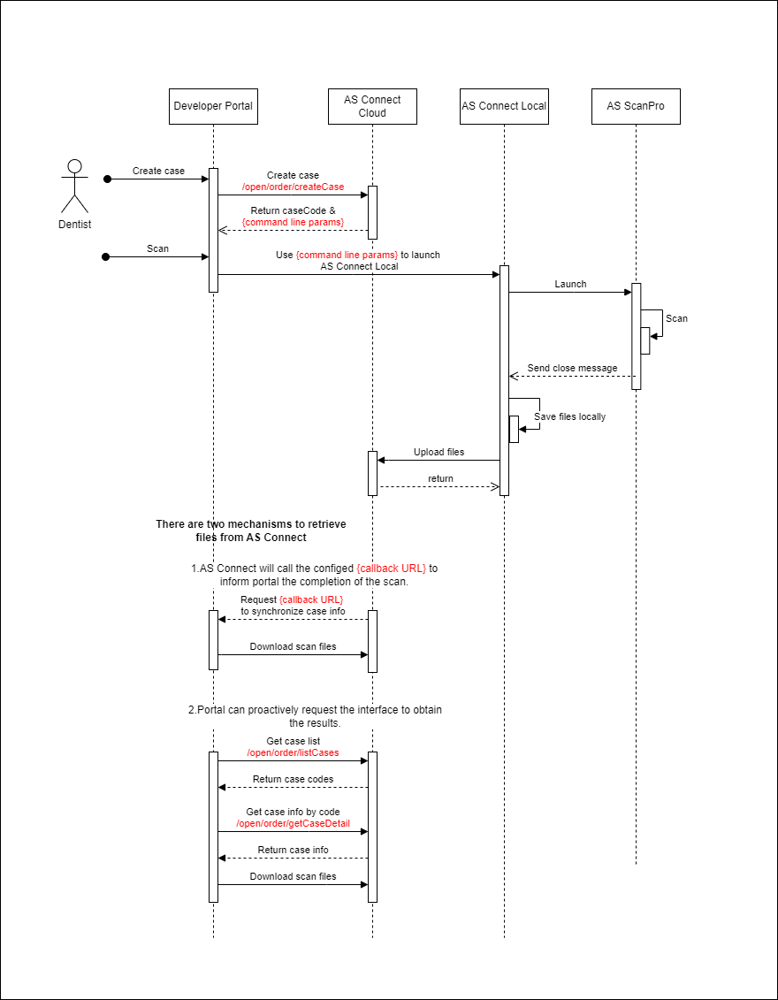
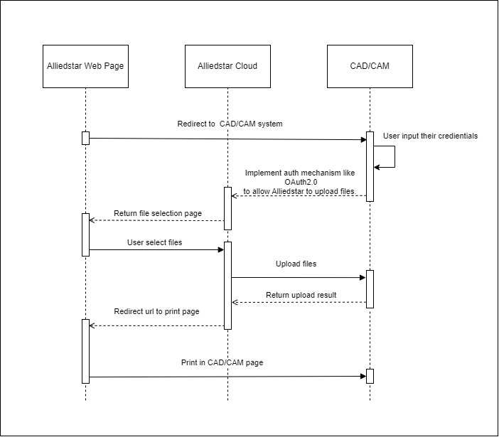
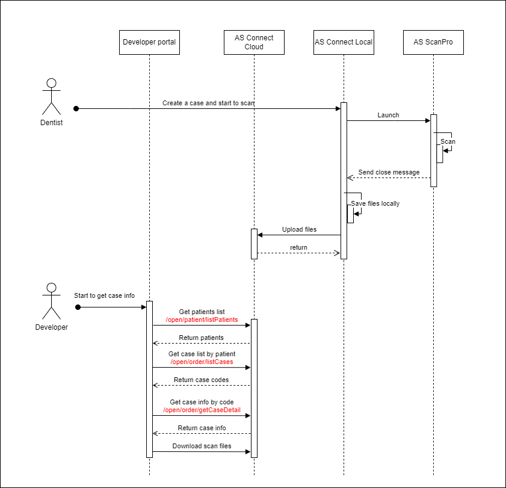
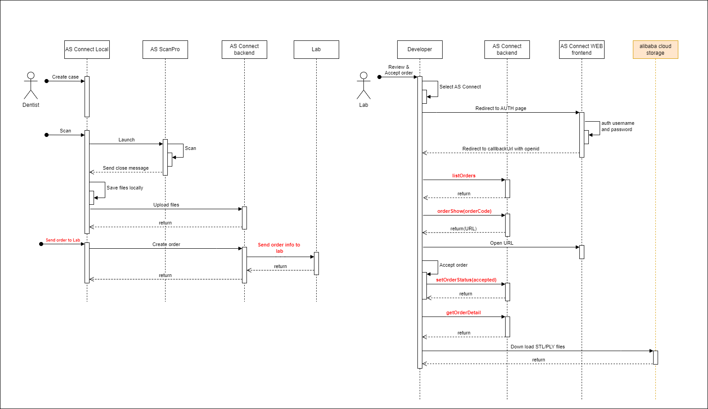

# Workflow Example
Here are some examples about what you can do with our APIs.

## DPMS
If you are a DPMS, this workflow may help you to finish the whole process which starts from creating case and ends from getting all scan related files.

## CAD/CAM
If you are a CAD/CAM and want users to upload files to your site proactively.

## Aligner designer
If you focus on cases info of patients, you can start from getting patients' info. 

## Laboratory platform
If you are a laboratory platform that has multiple labs registered in your system, you may retrieve order info when user send order to these labs.

