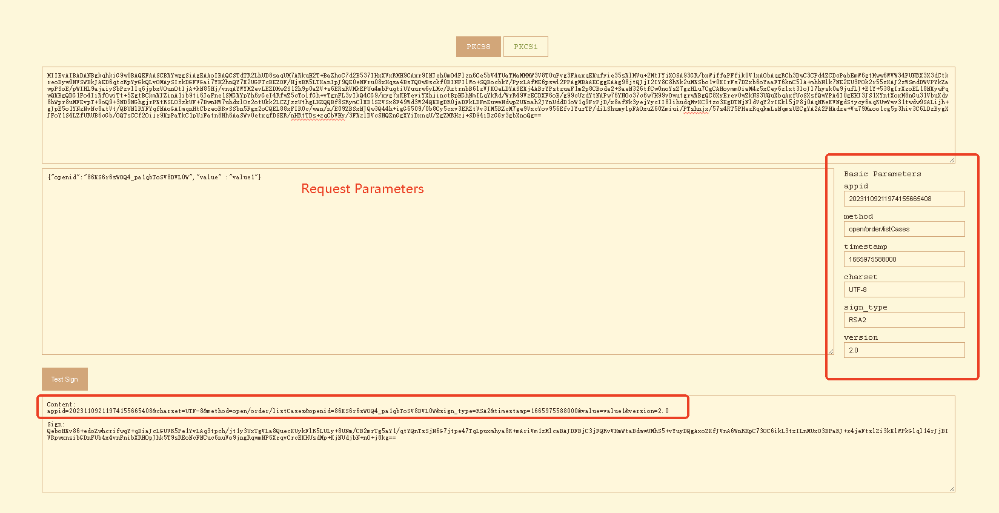

# Development Preparation and Security

## App ID

Alliedstar's administrator will assign an appid to each Developer needing to integrate with the open platform. This id serves as the Developer's unique identifier.

## Signature

To ensure the security of communications, all API requests between Developers and the open platform must include all request parameters in the signature verification.

### Public Key and Private Key

Developers and the open platform each hold a pair of public and private keys. The private keys are managed by the Developers and the open platform, while the public keys must be exchanged between them.

Whether the Developer is making a request to the open platform or the platform is making a callback request to the Developer's interface, each party must sign the request parameters with their own private key. The receiving party then verifies the signature using the sender's public key, ensuring the legitimacy of each request.

The open platform's public key, as well as the Developer's public and private keys, can currently be allocated by Alliedstar's administrator.

### Common Request Parameters

Regardless of which interface the Developer is requesting, certain common parameters are mandatory and must be included in the signature.

|  Parameter  |  Type  |  Remard  |  Example  |
| --- | --- | --- | --- |
|  appid  |  String  |  Developer’s app ID  |  20231109211974155665408  |
|  method  |  String  |  API route  |  open/order/listCases  |
|  charset  |  String  |  Encoding format Developers can choose the encoding format as needed. The default is UTF-8.  |  UTF-8  |
|  sign\_type  |  String  |  Algorithm, for security reasons, RSA2 is currently mandatory.  |  RSA2  |
|  version  |  String  |  Version, different version has it’s own algorithm. Current is 2.0  |  2.0  |
|  timestamp  |  String  |  Timestamp，milliseconds  |  1665975588000  |

### Signature Algorithm

Signature Algorithm: SHA256WithRSA. The specific signing process is as follows:

1. **Parameter Filtering and Sorting** Collect all request parameters, including common request parameters and business parameters for each interface, excluding byte-type parameters like files or byte streams. Remove the sign field and parameters with empty values. **If request parameter contains a complex Object, it should be converted to a JSON string.** Sort the parameters in ascending alphabetical order by name.

2. **Parameter Concatenation** Combine the sorted parameters into the format “parameterName=parameterValue” and concatenate them using the & character. This results in the string to be signed.

3. **Signing** Use the SHA256WithRSA algorithm along with the Developer's private key to hash and sign the string. Then, Base64 encode the result.

4. **Add Signature Parameter** Assign the generated signature to the sign parameter and append it to the request parameters.

5. **Private Key Format** Since different programming languages use different private key formats (e.g., Java uses PKCS8 while C# uses PKCS1), Developers should select the appropriate private key format for their development.

### Example

#### Simple Example

In the test environment, a test-specific Developer and a test-specific User have been configured for debugging signatures.

This test example can only call the `open/order/listCases` interface and is not subject to the timestamp time restrictions.

**Test Base URL**:  [https:// test-api.allied-star.com](https://test-api.allied-star.com)

**App Id:**  20231109211974155665408

**PKCS8 fomated private key (Java compatible):**

``` text
MIIEvAIBADANBgkqhkiG9w0BAQEFAASCBKYwggSiAgEAAoIBAQCSTdTR2LhUD8saqUM7AKkuH2T+BaZhoC7d2B537IHxXVxRMH9CAxr9INJeh0mO4Flzn6Ce5bV4TUaTMaMMMW3V8T0uPvg3FAaxqEKufyie35sKlMVu+2MtJYjXOSA93GR/bxWjffaPFfik0V1xAObAqgRCh3DwC3CPd4ZCDcPabEmW6gtMww6WVW34PUNRX3X3dCtkreoDyw0NVSWBkJAED6qtcRpYyGkQLvOMAySIzkDGFVGai7YH2hnQY7X2UGFTcBEZOF/HjsBR5LTXanIpJ9QE0eNFru08xHqsa4BsTQOwBsckf0BINFIlWo+SQBocbkY/PyxLAfME6pswl2PPAgMBAAECggEAAg98jtQJjI2IY8C8hKk2uMKSbo1v0XIrFs7DZxb6oYaaFT6knC5lA+mhbNlk7NE2EU3POk2r55zXAJ2zWSmdDWVPYkZawpPSoE/pWIHL9ajaiySbPzvlIq6jpbxVOunOtIjA+kN85Hj/vnqAYWYM2evLEZDMw2S12h9p0aZV+s6EKsRVMkEPUu4mbPuqtiUYuurw6yLMc/RztrnbB6lzVJKOeLDYASEKj4ABrYPstzuaF1m2p8CBode2+SaeN326tfCw0noYsZ7gzHLu7CgCAHoymmOiaM4z5xCey6zlxt3IoJl7hysk0a9jufLJ+E1Y+538gIrXzoEL18NKywPqwQKBgQDG1Fo4IiKfOwiTt+5ZgtBCkmKJZinA1ib9ti6JaFne1SMGKYpYh6yGeI4RfwZ5cTolfGh+vTgnFL3yIkQ4CG9/xyg7xKBTeviYXhjinctBpHGhNmILqYkRd/WrR49VzECDXF6oB/g99cUzdYtNAPw76YNOc37c6w7H99vOwutgrwKBgQC8XyErev0wZkNS3UQuXbqAxfUcSXsfQwYPA4I0gEHJ3JS1XYntXoxM8nGu31VbuXdy8hWpr8uMFEvpT+9oQ9+3ND9NGhgjrPKtRSLO3zkUF+7BwnHW7uhdxlOz2otUkk2LCZJzzUthgLHZQQBf8SRymClXD1SZVSx8F49Wd3W24QKBgDR0jaDFkLDFmEuweNdwpZUKnah2JYnUddD1oW1q9FrPjD/x8afNk3yejYycII8lihudqMvXC9tzo3EgDTNjNldVqY2rIEkl5jP8j0AqNReKVNgdStycy6aqKUwYwv31twdw9SALijh+gJpE5o1YNzNvNc8atVt/QBUNlRYFYqfNAoGAImqnHtCbzeoBRvSSbn5Fgx2oCQEL88xFIR0c/wan/n/E09ZBSxNJQw3Q44h+igG6509/0b8Cy5cxv3ERZtVv3IM5RZcM7ge9VxcYov956EfvIYurTP/diLShumylpFAOxuZ60Zmiui/PTshnjx/57s4KT5PHezRqqkmLsNqmsUECgYA2A2PNAdze+Vu79Maoo1cg5p3hiv3C6LDzBygXJFoY1S4LZfURUB6cGb/OQTsCCf2Oijr9KpPaTkC1pUjFatn8Nh6AaSWv0etxqfDSER/nHRtTDs+zqCbVHy/3FKzlDVcSNQZnGgXYiDxnqU/ZgZMRHzj+SD94iDzGGy3gbXnoQg==
```

**PKCS1 fomated private key (C# compatible)：**

```text
MIIEogIBAAKCAQEAkk3U0di4VA/LGqlDOwCpLh9k/gWmYaAu3dged+yB8V1cUTB/QgMa/SDSXodJjuBZc5+gnuW1eE1GkzGjDDFt1fE9Lj74NxQGsahCrn8ont+bCpTFbvtjLSWI1zkgPdxkf28Vo332jxX4pNFdcQDmwKoEQodw8Atwj3eGQg3D2mxJluoLTMMOllVt+D1DUV9193QrZK3qA8sNDVUlgZCQBA+qrXEaWMhpEC7zjAMkiM5AxhVRmou2B9oZ0GO19lBhU3ARGThfx47AUeS012pyKSfUBNHjRa7tPMR6rGuAbE0DsAbHJH9ASDRSJVqPkkAaHG5GPz8sSwHzBOqbMJdjzwIDAQABAoIBAAIPfI7UCYyNiGPAvISpNrjCkm6Nb9FyKxbOw2cW+qGGmhU+pJwuZQPpoWzZZOzRNhFNzzpNq+ec1wCds1kpnQ1lT2JGWsKT0qBP6ViBy/Wo2oskmz875SKuo6W8VTrpzrSIwPpDfOR4/756gGFmDNnryxGQzMNktdofadGmVfrOhCrEVTJBD1LuJmz7qrYlGLrq8OsizHP0c7a52wepc1SSjniw2AEhCo+AAa2D7Lc7mhdZtqfAgaHXtvkmnjd9urXwsNJ6GLGe4Mxy7uwoAgB6MppjomjOM+cQnsus5cbdyKCZe4crJNGvY7nyyfhNWPud/ICK186BC9fDSssD6sECgYEAxtRaOCIinzsIk7fuWYLQQpJiiWYpwNYm/bYuiWhZ3tUjBimKWIeshniOEX8GeXE6JXxofr04JxS98iJEOAhvf8coO8SgU3r4mF4Y4p3LQaRxoTZiC6mJEXf1q0ePVcxAg1xeqAf4PfXFM3WLTQD8O+mDTnN+3OsOx/fbzsLrYK8CgYEAvF8hK3r9MGZDUt1ELl26gMX1HEl7H0MGDwOCNIBBydyUtV2J7V6MTPJxrt9VW7l3cvIVqa/LjBRL6U/vaEPftzQ/TRoYI6zyrUUizt85FBfuwcJx1u7oXcZTs9qLVJJNiwmSc81LYYCx2UEAX/EkcpgpVw9UmVUsfBePVnd1tuECgYA0dI2gxZCwxZhLsHjXcKWVCp2odiWJ1HXQ9aFtavRaz4w/8fGnzZN8no2MnCCPJYobnajL1wvbc6NxIA0zYzZXVamNqyBJJeYz/I9AKjUXilTYHUrcnMumqilMGML99bcHcPUgC4o4foCaROaNWDczbzXPGrVbf0AVDZUWBWKnzQKBgCJqpx7Qm83qAUb0km5+RYMdqAkBC/PMRSEdHP8Gp/5/xNPWQUsTSUMN0OOIfooBuudPf9G/AsuXMb9xEWbVb9yDOUWXDO4HvVcXGKL/eehH7yGLq0z/3Yi0obpspaRQDsbmetGZorovz07IZ48f+e7OCk+Tx3s0aqpJi7DaprFBAoGANgNjzQHc3vlbu/TGqKNXIOad4Yr9wuiw8wcoFyRaGNUuC2X1EVAenBm/zkE7Agn9joo6/SqT2k5AtaVIxWrZ/DYegGklr9Hrcanw0hEf5x0bUw7Ps6gm1R8v9xSs5Q1XEjUGZxoF2Ig8Z6lP2YGTER84/kg/eIg8xhst4G156EI=
```

**Test user openid:** 86KS6r6sWOQ4\_pa1qbToSV8DVL0W

**API route:**  open/order/listCases

**Required business parameter:**

|  Parameter  |  Type  |  Remard  |  Example  |
| --- | --- | --- | --- |
|  openid  |  String  |  user openid  |  86KS6r6sWOQ4\_pa1qbToSV8DVL0W  |

**After filling the common and business parameters with example values, merging, and sorting them, the resulting string is as follows:**

`appid=20231109211974155665408&charset=UTF-8&method=open/order/listCases&openid=86KS6r6sWOQ4\_pa1qbToSV8DVL0W&sign\_type=RSA2&timestamp=1665975588000&version=2.0`


**Sign the string using the SHA256WithRSA algorithm and the Developer's private key to obtain the signature result.**

```text
EJ+YWQGrQtR8Fyk4vT7EGrwEMP7PA1wMy4Nymuxm1pLJxovBlX2psAyRybYI3VGGsnYC6UlZcmq2eIXX1lkP/kA/HUi1hPmwUbWyRdXAuSgMNQWzoXoM9W8YTAwI1SUtbucKBUABqHoWYafJygtqRoaVFu9BnNlxFS8RZCtnRdiohKC9ENeEfCm6lMVtnPMPEzUeHe08OiHxwcw9DtrzmXe3NMtChdRp4DqQJYUOQoLhdZA78TrxKCNjA3y+mIyIXZz5aOCuIS/+fI8gJ6c0HGZLoWxH/DYQgSHqBbl7wkgprmVryW418btn8t3yipxMZzBqjZQeCt2m3YNzk1uX/g==
```

**Add the signature to the request parameters with the parameter name sign. The final complete request parameters are:**

```json
{
	"appid": "20231109211974155665408",
	"charset": "UTF-8",
	"method": "open/order/listCases",
	"openid": "86KS6r6sWOQ4_pa1qbToSV8DVL0W",
	"timestamp": "1665975588000",
	"sign_type": "RSA2",
	"version": "2.0",
	"sign": "EJ+YWQGrQtR8Fyk4vT7EGrwEMP7PA1wMy4Nymuxm1pLJxovBlX2psAyRybYI3VGGsnYC6UlZcmq2eIXX1lkP/kA/HUi1hPmwUbWyRdXAuSgMNQWzoXoM9W8YTAwI1SUtbucKBUABqHoWYafJygtqRoaVFu9BnNlxFS8RZCtnRdiohKC9ENeEfCm6lMVtnPMPEzUeHe08OiHxwcw9DtrzmXe3NMtChdRp4DqQJYUOQoLhdZA78TrxKCNjA3y+mIyIXZz5aOCuIS/+fI8gJ6c0HGZLoWxH/DYQgSHqBbl7wkgprmVryW418btn8t3yipxMZzBqjZQeCt2m3YNzk1uX/g=="
}

```

**Full curl request:**

```text
curl -X POST -d"appid=20231109211974155665408&charset=UTF-8&method=open%2Forder%2FlistCases&openid=86KS6r6sWOQ4\_pa1qbToSV8DVL0W&sign\_type=RSA2&timestamp=1665975588000&version=2.0&sign=EJ%2BYWQGrQtR8Fyk4vT7EGrwEMP7PA1wMy4Nymuxm1pLJxovBlX2psAyRybYI3VGGsnYC6UlZcmq2eIXX1lkP%2FkA%2FHUi1hPmwUbWyRdXAuSgMNQWzoXoM9W8YTAwI1SUtbucKBUABqHoWYafJygtqRoaVFu9BnNlxFS8RZCtnRdiohKC9ENeEfCm6lMVtnPMPEzUeHe08OiHxwcw9DtrzmXe3NMtChdRp4DqQJYUOQoLhdZA78TrxKCNjA3y%2BmIyIXZz5aOCuIS%2F%2BfI8gJ6c0HGZLoWxH%2FDYQgSHqBbl7wkgprmVryW418btn8t3yipxMZzBqjZQeCt2m3YNzk1uX%2Fg%3D%3D" https://test-api.allied-star.com/open/order/listCases
```

**Note**: To correctly execute the curl command, both the method and sign values have been URL-encoded.

#### Advanced Example

If request parameter contains a complex Object, it should be converted to a JSON string. This Example involves a request that contains a complex Object. Apart from the request parameters and API router, which differ from the pervious Example, the appid and private key remain the same.

**API route:**  open/order/createCase

**After filling the common and business parameters with example values, merging, and sorting them, the resulting string is as follows:**

`appid=20231109211974155665408&birthDate=2020-05-18&caseName=test&charset=UTF-8&externalCaseCode=20230517C018&externalPatientCode=TEST001-HJ-UUID&format=json&gender=1&method=open/order/createCase&openid=86KS6r6sWOQ4_pa1qbToSV8DVL0W&patientName=as-hj-001&sign_type=RSA2&timestamp=2025-04-17 13:12:51&treatments=[{"number":"12","scan":"0","toothType":"0"}]&version=1.0`

**Sign the string using the SHA256WithRSA algorithm and the Developer's private key to obtain the signature result.**

```text
a4swwCmJRVYbjlJZkV2pQHaMAwTa4xdogNWMjG+7OQvJEeR+iVhIS0yaBhrmsp276+bVUF+Gk+lmjoArA6GPJPVa4byMbLlBrWh0PnPvxNUROFT7hJKFKG1Xrf7Ma+UxTgHai8hcIRBFB0NEk8wXWmPAI6YAm7IhNaD+lh/jU1NlnIv5cpcMj0HtT0lBlb7SmQdklb6ULD/7IdLnACWbulmCg0x9E2iyOgOiwytvEWeo1UNIKOsPS46SH8mkaDFdQATJuf1LpPhQsElHKwvXkwE6f8kvEQRBOINWvu7SpDPP6FyfVmYkRQcpctQjJoXeqebpAWCSPCnbXXaDiaGefw==
```

### More Help

#### Generate Test Signatures Online

We provide an online signature generation test website where developers can input information to verify if the signature generation is correct.

**Test Website:** https://test.allied-star.com/signtest/



#### SDK

We offer SDKs in Java and C#, which include example code. Developers can use these directly or refer to the examples to implement the algorithms themselves. [Please see SDK Download](#SDK-Download)

## Authorization

### Summary

User authorization refers to the process by which a User grants the Developer to access their account information on our open platform.

When the Developer needs to access information such as cases or orders related to the User, they must first obtain the User's authorization. Once granted, the open platform will notify the Developer of the User’s openid and any other relevant information, either via a synchronous redirect or an asynchronous notification. The authorization is a one-time process.

### Authorization Flow Diagram


### Authorization Page

`https://{baseurl}/third/v2/auth-login?appid={appid}&redirectUrl={redirectUrl} &outUid={outUid}&notifyUrl={notifyUrl}`

|  Parameter  |  Type  |  Remark  |  Required  | Example                  |
| --- | --- | --- | --- |--------------------------|
|  appid  |  String  |  Developer’s appid  |  YES  | 20231109211974155665408  |
|  redirectUrl  |  String  |  Sync redirect URL after authorization (If empty, no synchronous redirect will occur)  |  NO  | http%3A%2F%2Fexample.com |
|  outUid  |  String  |  User id in developer’s system  |  NO  | example_userid           |
|  notifyUrl  |  String  |  Asynchronous notification URL after authorization (If empty, no asynchronous notification will occur)  |  NO  | http%3A%2F%2Fexample.com |

### Get User Information

|  Parameter  |  Type  |  Remark  |  Example  |
| --- | --- | --- | --- |
|  openid  |  String  |  User's identity  |  86KS6r6sWOQ4\_pa1qbToSV8DVL0W  |
|  unionid  |  String  |  User's organization identity  |  86KS6r40LSq5z6TLWi0c7742tCEK  |
|  realName  |  String  |  User's real name  |  Tomas Smith  |
|  avatar  |  String  |  User's avatar  |  http://avatar.com/John  |
|  nickName  |  String  |  User's nickname  |  Tom  |
|  email  |  String  |  User's email  |  signtest@example.com  |
|  region  |  String  |  The site user belongs to  |  CN  |

**Synchronize Redirect:**

The information will be appended to the end of {redirectUrl}.

{redirectUrl}?openid={openid}&realName={realName}&avatar={avatar}&nickName={nickName}&email={email}&region={region}&unionid={unionid}

**Asynchronous Notification：**

The information will be sent to {notifyUrl} using POST.

**Request-Type**: `POST`

**Content-Type**: `application/json; charset=utf-8`

**Request Parameter**:

```json
{
    "openid":"{openid}",
    "realName":"{realName}",
    "avatar":"{avatar}",
    "nickName":"{nickName}",
    "email":"{email}",
    "region":"{region}",
    "unionid":"{unionid}"
}
```

### Example

Using the previously mentioned test-specific Developer as an example:

**Authorization page：**

https://test.allied-star.com/third/v2/auth-login?appid=20231109211974155665408&redirectUrl=http%3A%2F%2Fexample.com&outUid=123&notifyUrl=http%3A%2F%2Fexample.com

**Account：**

account：signtest@gmail.com

password：123456

site：CN

Taking synchronous redirect as an example for obtaining user information: After successful authentication, you will be redirected to {redirectUrl}, with the user's information attached:

https://example.com/?openid=86KS6r6sWOQ4_pa1qbToSV8DVL0W&realName=SignTest&avatar=https://alliedstar-sh-outtest.oss-cn-shanghai.aliyuncs.com/user%2Favatar%2F1701070385261-2d6230577.png&nickName=&email=signtest@gmail.com&region=CN&unionid=86KS6r40LSq5z6TLWi0c7742tCEK

## Host for Different Sites

Alliedstar has deployed sites in multiple countries, with data isolated between sites. Developers can choose the site that best suits their business needs for integration.

|  Region  |  Location of server  |  AS Connect Host  |  Api Host  |
| --- | --- | --- | --- |
|  Test-cn  |  Shanghai  |  https://test.allied-star.com  |  https://test-api.allied-star.com  |
|  China  |  Shanghai  |  https://asconnect-cn.allied-star.com  |  https://api.allied-star.com  |
|  Europe  |  Frankfurt  |  https://asconnect-eu.allied-star.com  |  https://api-eu.allied-star.com  |
|  United Kingdom  |  London  |  https://asconnect-uk.allied-star.com  |  https://api-uk.allied-star.com  |
|  US & Canada  |  Silicon Vally  |  https://asconnect-us.allied-star.com  |  https://api-us.allied-star.com  |
|  Japan  |  Tokyo  |  https://asconnect-jp.allied-star.com  |  https://api-jp.allied-star.com  |
|  Others  |  Singapore  |  https://asconnect.allied-star.com  |  https://api-en.allied-star.com  |

## SDK Download

### Java SDK :

https://images-en.allied-star.com/opensdk/sdk-java.rar

### C# SDK: 

https://images-en.allied-star.com/opensdk/sdk-csharp.rar

SDK for other languages are coming soon...


